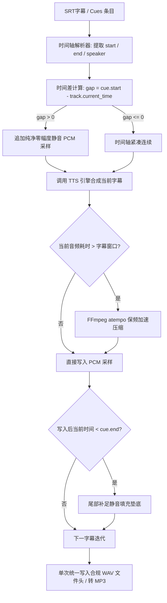

# OneTTS 字幕时间轴对齐配音与零爆音缝合策略

> **文档定位**：本文档系统性阐述 OneTTS 在视频配音（Dubbing）、字幕对齐（Subtitle-Aligned Synthesis）、音频时间轴留白缝合与大模型声音克隆方向的技术架构、算法实现与工程设计。

---

## 1. 核心挑战与业务痛点

传统的文本转语音（Text-to-Speech）引擎通常面向“流式播报”或“整篇长文本朗读”，但在影视剪辑、自媒体短视频出海、游戏配音等**视频字幕配音（Dubbing）场景**中，面临三大痛点：

1. **缺失留白空间（Silence Gaps）**：
   - 视频字幕之间存在大量天然空白（如画面人物停顿、场景转换、背景音乐空档）；
   - 传统 TTS 连续合成出来的音频没有时间戳和留白，与视频画面节奏完全错位。
2. **多片段音频拼接的爆音（Click/Pop Artifacts）**：
   - 很多开发者直接将多个生成的 `.wav` 文件通过原始二进制拼接（`b"".join(wav_list)`）；
   - 这会导致 WAV 文件头混乱破坏、采样点零点不连续，在交界处产生刺耳爆音与播放器解码崩溃。
3. **字幕时间窗口碰撞（Collision & Overflow）**：
   - 某些语种（如英语译成西语/俄语）字符变长，TTS 念完该句耗时可能超过原字幕留出的时间窗口，导致覆盖后续语句或音频堆积。

---

## 2. 核心架构：音频时间轴轨道 (`AudioTimelineTrack`)

为了从根源上解决时间轴对齐与爆音问题，OneTTS 在 `server/utils/audio_stitcher.py` 中实现了基于 PCM 采样层的零爆音缝合引擎。

### 2.1 架构原理图



### 2.2 核心设计规范
- **统一采样率与位深**：默认统一至 24,000 Hz（或 48,000 Hz）、16-bit PCM 单声道；
- **采样对齐计算**：
  $$\text{Sample Count} = \text{round}(\text{Duration (seconds)} \times \text{Sample Rate})$$
  $$\text{Silence Bytes} = \text{Sample Count} \times \text{Channels} \times \text{Sample Width}$$
  使用全零字节 `b"\x00"` 精准填充，彻底告别二进制 WAV 头混乱与 POP 杂音。
- **纯 Python 重采样支持**：内置轻量级线性插值转换，在底层音频采样率不一致时自适应无损降维，无需外部庞大重采样库即可完成对齐。

---

## 3. 字幕时间轴配音服务 (`DubbingService`)

在 `server/services/dubbing_service.py` 中提供了完整的自动化字幕配音工作流：

### 3.1 智能 SRT 字幕解析
- 支持标准 SRT 毫秒时间格式：`00:01:23,456 --> 00:01:25,789`；
- 支持多种主流说话人前缀正则提取：
  - `[Speaker 1] 你好，世界！` $\rightarrow$ 角色 `Speaker 1`，文本 `你好，世界！`
  - `旁白: 从前有座山` $\rightarrow$ 角色 `旁白`，文本 `从前有座山`

### 3.2 语速自适应保频压缩（Adaptive Speedup）
当 TTS 生成的语音时长超出字幕给定的物理窗口（`window_duration`）时，为避免与下一段台词冲突：
1. 动态计算必要加速比率：
   $$\text{Speed Ratio} = \frac{\text{Actual Duration}}{\text{Target Window Duration}}$$
2. 设置安全加速上限（默认限制不超过 1.5x），避免过快失真；
3. 调用 FFmpeg 音频滤镜 `-filter:a atempo={ratio}` 进行保频无损加速（保持音高 Pitch 不变）。

### 3.3 尾部留白静音补偿
若台词念完后早于当前字幕结束时间，轨道会自动向后补齐差值静音，确保下一句字幕能够在精确的时间点切入。

---

## 4. 多角色音色映射与大模型声音克隆

### 4.1 多角色音色动态路由 (`voice_mapping`)
在剧本演播与多角色对话中，请求体可提供清晰的角色绑定字典：
```json
{
  "voice_mapping": {
    "旁白": "zh-CN-YunxiNeural",
    "主角": "cosyvoice-chinese-male",
    "反派": "cosyvoice-clone"
  }
}
```
调度器逐句匹配对应的底层引擎与发音人参数，若未指定则自动回退至 `default_voice`。

### 4.2 阿里 CosyVoice 零样本声音克隆 (`CosyVoiceEngine`)
- **零样本瞬时克隆 (Zero-Shot Voice Cloning)**：仅需上传 3~10 秒参考音频与参考文本（Prompt Text & Prompt Audio），即可逼真复刻目标音色；
- **自然度与情感控制**：大语言模型架构（LLM-based TTS）天然具备上下文语义理解与拟人停顿；
- **双模部署弹性**：
  1. **本地模型常驻**：直接调用原生 Python SDK 与 GPU 推理；
  2. **微服务 HTTP 转发**：通过配置 `api_url` 代理转发至独立算力机，实现算力与 Web API 解耦。

---

## 5. API 协议与落地实践

### 5.1 字幕配音专属端点 `POST /v1/tts/dubbing`

#### 请求参数核心结构
| 字段 | 类型 | 必填 | 说明 |
| :--- | :--- | :---: | :--- |
| `model` | string | 是 | 基础模型或引擎（如 `edgetts`, `cosyvoice`） |
| `cues` | list | 否 | 结构化字幕列表（含 `start_seconds`, `end_seconds`, `text`, `speaker`） |
| `srt_content` | string | 否 | 原始 SRT 文本（与 `cues` 二选一，自动优先解析） |
| `voice_mapping` | dict | 否 | 说话人角色到具体 Voice ID 的映射字典 |
| `response_format` | string | 否 | 输出音频格式：`wav`（默认无损）或 `mp3` |
| `output_mode` | string | 否 | `audio`（直接下载音频流）或 `json`（返回 Base64 及对齐统计） |

#### JSON 模式响应结果示例
```json
{
  "audio_base64": "UklGRi...",
  "format": "wav",
  "total_duration_seconds": 12.5,
  "total_cues": 4,
  "silence_gaps_count": 3,
  "total_silence_duration": 4.2
}
```

### 5.2 异步长任务队列支持 (`POST /v1/tts/tasks`)
- 任务创建服务 `TaskService` 深度集成 `AudioTimelineTrack`；
- 当传入超长 SRT 影视剧本时，后台协程自动分批渲染、异步写盘并记录进度，支持 Webhook 回调通知与 Zip 打包下载（含对齐音频与校准后字幕）。
